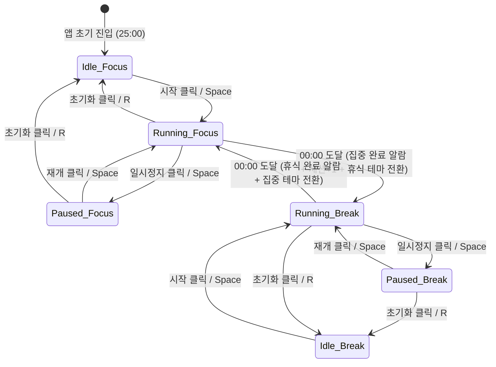

# 포모도로 타이머 웹 앱 — 프로젝트 개요 및 기능명세서

> 본 문서는 실제 구현된 포모도로 타이머 웹 앱의 확정된 구조, 기술 스택 및 상세 기능 명세를 정리한 최종 문서입니다.

---

## 1. 프로젝트 개요

### 1.1 프로젝트 목적
사용자가 **25분 집중 + 5분 휴식**의 포모도로 기법을 방해 없이 실천할 수 있도록 돕는 반응형 웹 애플리케이션입니다. 시각적 진행률(원형 링 및 동적 배경 테마), 청각적 몰입 환경(Web Audio API 내장 자연 백색소음), 그리고 세션 종료 알림 및 기록 기능을 단일 화면에서 직관적으로 제공합니다.

### 1.2 기술 스택 및 아키텍처
별도의 빌드 도구나 로컬 서버 없이 `index.html` 파일을 브라우저로 직접 열어(`file://`) 즉시 실행할 수 있도록 구성했습니다.

| 구분 | 기술 | 적용 내용 |
| :--- | :--- | :--- |
| **마크업** | HTML5 (Semantic + SVG) | 시맨틱 구조, ARIA 접근성 속성, `viewBox="0 0 280 280"` SVG 원형 진행 링 |
| **스타일** | CSS3 (Custom Properties, Flexbox/Grid, Transitions) | `body::before`/`::after` 이중 레이어 배경 크로스페이드, 둥근 버튼 호버 애니메이션, 반응형 UI |
| **로직** | Vanilla JavaScript (`defer` IIFE 모듈 패턴) | `file://` 환경 CORS 제약 없이 동작하는 모듈 분리 구조 |
| **오디오** | Web Audio API (100% 내장 합성 엔진) | 외부 링크 만료/네트워크 단절 없이 파도·비·새 소리 및 종료 알림음 실시간 합성 |
| **데이터 저장** | `localStorage` | 완료 세션 수, 백색소음 음량, 음소거 상태 영구 저장 (제한 환경 안전 폴백 포함) |

### 1.3 프로젝트 파일 구조
```text
프로젝트10/
├── index.html                  # 메인 마크업, SVG 원형 링, 제어 UI 및 패널 구성
├── project_specification.md    # 프로젝트 개요 및 확정 기능명세서
├── css/
│   └── styles.css              # 집중/휴식 동적 테마, 원형 링, 버튼 호버 애니메이션, 반응형 스타일
└── js/
    ├── storage.js              # localStorage 안전 래퍼 (세션 카운터·음량·음소거 저장)
    ├── audio.js                # Web Audio API 백색소음(파도·비·새 소리) 및 종료 알림음 엔진
    ├── timer.js                # Date.now() 보정 포모도로 타이머 및 자동 전환 엔진
    └── main.js                 # UI 바인딩, 탭 제목·파비콘 동기화, 단축키 및 토스트 제어
```

---

## 2. 확정 기능명세서 (Functional Specification)

### F-01. 포모도로 타이머 및 자동 전환
- **기본 시간 설정**: 집중 시간 **25분(`25:00`)**, 휴식 시간 **5분(`05:00`)**을 1세트로 구성합니다.
- **자동 전환 로직**:
  - 집중 시간이 `00:00`에 도달하면 집중 완료 알림음을 재생하고, 완료 세션 카운터를 `+1` 증가시킨 뒤 **휴식 모드(`05:00`)로 자동 전환**하여 연속 실행합니다.
  - 휴식 시간이 `00:00`에 도달하면 휴식 완료 알림음을 재생하고 **집중 모드(`25:00`)로 자동 전환**하여 연속 실행합니다.
  - 모드 전환 시 상단 토스트 배너로 안내 메시지를 표시합니다.
- **정확도 보정**: `requestAnimationFrame`과 200ms `setInterval`을 병행하고 `Date.now()` 기준 목표 종료 시각(`endTime`)과의 차이로 남은 시간을 계산하여 백그라운드 탭에서도 오차 없이 동작합니다.
- **테스트 모드 (빠른 검증용)**: 상단 `테스트 모드 (5초/3초)` 토글을 켜면 집중 5초 / 휴식 3초로 전환되어 자동 전환, 배경 변화, 알림음, 세션 카운터를 즉시 테스트할 수 있습니다.

### F-02. 타이머 제어 버튼 (시작 / 일시정지 / 초기화) 및 단축키
| 버튼 | 동작 설명 | 활성화 조건 |
| :--- | :--- | :--- |
| **시작 / 재개 (Start)** | 타이머를 시작하거나 일시정지 상태에서 재개합니다. 클릭 시 `AudioContext`를 활성화합니다. | 대기 / 일시정지 상태 |
| **일시정지 (Pause)** | 남은 시간을 유지한 채 카운트다운을 중지합니다. | 실행 중 상태 |
| **초기화 (Reset)** | 타이머를 중지하고 현재 모드의 초기 시간(`25:00` 또는 `05:00`, 테스트 모드 시 `00:05`/`00:03`)으로 되돌립니다. | 항상 가능 |

- **키보드 단축키**: 입력 요소나 버튼에 포커스가 없을 때 `Space`로 시작/일시정지, `R`로 초기화를 실행할 수 있습니다.

### F-03. 원형 진행 링 및 중앙 타이머 디스플레이
- **중앙 대형 타이머**: 화면 정중앙에 `MM:SS` 형식으로 남은 시간을 표시하며 `font-variant-numeric: tabular-nums`로 숫자 흔들림을 방지합니다.
- **원형 진행 링**: 반지름 `124`의 SVG 원형 트랙과 발광 필터(`#ring-glow`)가 적용된 진행 바(`stroke-dasharray`, `stroke-dashoffset`)가 시간이 지남에 따라 부드럽게 채워집니다.
- **상태 안내 및 진행률**: 타이머 하단에 현재 상태 문구와 경과 진행률(`N% 완료`)을 함께 표시합니다.

### F-04. 브라우저 탭 제목(`document.title`) 및 파비콘 실시간 동기화
- **집중 실행 중**: `24:59 | 집중 - 포모도로`
- **휴식 실행 중**: `04:59 | 휴식 - 포모도로`
- **일시정지 중**: `⏸ 24:59 | 집중 - 포모도로` (또는 `휴식`)
- **초기/대기 상태**: `포모도로 타이머`
- **동적 파비콘**: 집중 모드(코랄 `#ff6b6b`)와 휴식 모드(민트 `#38d9a9`)에 맞춰 브라우저 탭 아이콘 색상이 실시간으로 전환됩니다.

### F-05. 백색소음 플레이어 (파도 / 비 / 새 소리)
외부 오디오 서버 의존성 없이 **Web Audio API 100% 내장 자연음 합성 엔진**으로 구현되었습니다.
- **파도 (`wave`)**: 저역 브라운 노이즈 + 약 8초 주기(0.125Hz) LFO 필터/음량 변조 + 대역 통과 핑크 노이즈 거품 레이어
- **비 (`rain`)**: 대역/저역 필터링된 따뜻한 핑크 노이즈 빗줄기 + 고역 빗소리 잔물결 레이어
- **새 소리 (`birds`)**: 잔잔한 숲속 바람 배경 + 2~4음절 주파수 스윕 지저귐 랜덤 스케줄러(스테레오 패닝 지원)
- **재생 제어**: 각 버튼을 클릭해 전환하며, 활성화된 버튼을 다시 클릭하면 꺼집니다. 재생 중인 버튼에는 3단 미니 이퀄라이저 애니메이션이 표시됩니다(음소거 시 정지).
- **음량 조절 및 음소거 표시**:
  - `0% ~ 100%` 슬라이더로 실시간 음량 조절 및 `localStorage` 자동 저장
  - 음소거 토글 버튼 클릭 시 아이콘 전환, 상단 상태 배지 `음소거됨` 표시, 수치 `음소거` 표시 및 슬라이더 비활성 시각화
  - 음소거 해제 시 음소거 직전의 음량 자동 복원 (음량 슬라이더를 `0%`로 내려도 자동 음소거, 다시 올리면 자동 해제)

### F-06. 세션 종료 알림음 (알람)
- **독립 채널 출력**: 백색소음의 재생 여부나 음소거 상태와 무관하게 별도 오디오 경로로 항상 알림음이 울립니다.
- **모드별 사운드 구분**:
  - 집중 완료 시: 성취감을 주는 밝은 4음 상승 차임 (`C5 → E5 → G5 → C6`, 사인파 + 트라이앵글 배음)
  - 휴식 완료 시: 다시 집중을 알리는 차분한 2음 벨 반복 (`G4 → D5 × 2`)
- **미리듣기 기능**: 화면 하단의 `알림음 미리듣기` 버튼으로 현재 모드의 종료 알림음을 언제든 테스트할 수 있습니다.

### F-07. 완료 세션 카운터 (Session Counter)
- **증가 기준**: 집중 세션이 `00:00`까지 완료될 때마다 `+1` 증가합니다(휴식 완료 및 수동 초기화 시 미증가).
- **시각화 및 저장**:
  - 완료 횟수(`N회`) 증가 시 확대 바운스 애니메이션(`bump`) 적용
  - 4세션 포모도로 주기 도트 표시 및 누적 집중 시간(`N × 25분`) 안내
  - `localStorage`에 영구 저장되어 새로고침 후에도 유지되며, `기록 초기화` 버튼(확인 대화상자 포함)으로 리셋 가능

### F-08. 모드별 동적 배경 테마 전환
`document.body.dataset.mode`(`focus` / `break`) 속성에 따라 이중 배경 레이어의 투명도가 `0.65s cubic-bezier(0.4, 0, 0.2, 1)`로 부드럽게 크로스페이드됩니다.

| 모드 | 배경 그라데이션 | 포인트 컬러 (`--accent`) | 원형 링 (`--ring-stroke`) |
| :--- | :--- | :--- | :--- |
| **집중 모드 (`focus`)** | 딥 웜 테라코타 · 버건디 슬레이트 (`#1b1117` → `#592430`) | 코랄 (`#ff6b6b`) | `#ff7b7b` |
| **휴식 모드 (`break`)** | 딥 세이지 · 오션 틸 (`#0d1d22` → `#1b5055`) | 민트 (`#38d9a9`) | `#51e5b8` |

### F-09. UI/UX 디자인 및 버튼 호버 애니메이션
- **둥근 모서리**: 주요 제어 버튼(`border-radius: 999px` Pill 스타일)과 사운드 카드(`16px`), 패널(`20px`), 메인 카드(`28px`) 전반에 부드러운 곡률을 적용했습니다.
- **Hover / Active 인터랙션**:
  - `:hover`: 위로 부드럽게 떠오르는 이동(`translateY(-3px)`), 그림자 확장, 대각선 광택 스위프(`::after`), 초기화 아이콘 회전(`-180deg`)
  - `:active`: 탄성 있는 눌림 효과(`scale(0.97)`)
- **접근성 및 반응형**: `640px` 이하 모바일 1열 전환 레이아웃, 키보드 포커스 링(`:focus-visible`), `prefers-reduced-motion` 모션 축소 환경 대응을 지원합니다.

---

## 3. 상태 전이 흐름도


